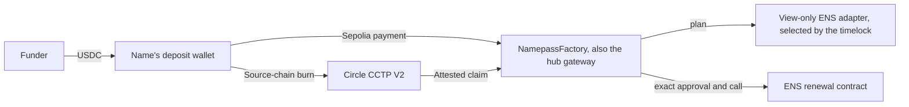

# Namepass

USDC-funded ENS renewals from universal deposit wallets.

[How it works](#how-it-works) · [Contracts and trust](#contracts-and-trust) ·
[Pricing](#exact-ens-pricing) · [Deployment evidence](docs/DEPLOYMENTS.md)

> [!WARNING]
> Namepass is deployed on testnets only. Its contracts have not had an external audit.
> Do not send mainnet funds to a testnet deposit address.

Namepass lets anyone fund an ENS name without owning it. Each normalized `.eth` label maps to a
universal deposit wallet within one deployment set. A funder sends the configured USDC to that
wallet. Any executor can then convert its balance into renewal time at ENS's on-chain price.
The payment route is permissionless: it does not depend on the Namepass website or its automation.

The **October 23, 2026 testnet deployment** replaced the September 22 factory. Its deposit
addresses differ from every previous deployment, and the previous addresses are retired. Derive
addresses from the [current factory](docs/DEPLOYMENTS.md) before funding them.

## How it works

1. Normalize the ENS name. Call `NamepassFactory.predictWallet(label)` with the label, such as
   `vitalik`, without `.eth`. CREATE2 derives the same wallet address on each chain in the current
   deployment set.
2. Send the configured USDC to that wallet on a supported testnet. Arc Testnet also accepts its
   native USDC through the wallet.
3. Anyone can call `NamepassFactory.renew` to process the wallet balance. On Ethereum Sepolia the
   wallet itself pays ENS. On the other supported chains the wallet burns through Circle CCTP V2
   to the factory's own address on Sepolia.
4. After Circle attests a burn, anyone can submit its message and attestation to
   `NamepassFactory.completeCCTP` on Sepolia. The factory asks the active adapter for a plan and
   settles the renewal.

The executor receives a fixed **0.10 USDC allowance** on successful settlement. Circle's actual
fee, when applicable, also comes from the processed amount. Balances remain separate by chain.
A payment above Circle's per-message burn limit is processed in slices.

The deposit wallet is an ERC-1167 proxy derived from the factory. It has no private key to hold or
recover. The full wallet address is the funding target. Optional `<label>.namepass.eth` resolution
is separate from payment execution.

## Contracts and trust

| Contract | Role |
| --- | --- |
| [NamepassFactory](contracts/NamepassFactory.sol) | Derives wallets, authenticates funding, completes CCTP claims, settles payments, and selects the adapter through its governance executor |
| [ENSV2RenewalAdapter](contracts/ENSV2RenewalAdapter.sol) | View-only: selects the ENS renewal path, calculates the exact duration and returns the exact call |
| [NamepassResolver](contracts/NamepassResolver.sol) | Provides optional ENSIP-10 and CCIP-Read resolution |

### Verified testnet deployments

Sourcify shows matching deployed bytecode and source for the October 23 contracts:

| Contract | Network | Verified source |
| --- | --- | --- |
| NamepassFactory | Ethereum Sepolia | [Sourcify](https://repo.sourcify.dev/11155111/0xC4Fb9AED5d7b812AA3689aA4B9400671dd665E79) |
| NamepassFactory | Base Sepolia | [Sourcify](https://repo.sourcify.dev/84532/0xC4Fb9AED5d7b812AA3689aA4B9400671dd665E79) |
| NamepassFactory | Arbitrum Sepolia | [Sourcify](https://repo.sourcify.dev/421614/0xC4Fb9AED5d7b812AA3689aA4B9400671dd665E79) |
| NamepassFactory | Arc Testnet | [Sourcify](https://repo.sourcify.dev/5042002/0xC4Fb9AED5d7b812AA3689aA4B9400671dd665E79) |
| ENSV2RenewalAdapter | Ethereum Sepolia | [Sourcify](https://repo.sourcify.dev/11155111/0x4A468177187999F125dCE99a5eBD5F82Ab8D3481) |

| NamepassResolver, `namepass.eth` on Sepolia | Ethereum Sepolia | [Sourcify](https://repo.sourcify.dev/11155111/0xDa617E9C8c16fAA756CbA0565835c9Ef81B4b092) |

These links show source matches, not a security audit. See the
[deployment manifest](docs/deployments/2026-10-23/protocol-deployment-manifest.json) and the
[resolver record](docs/deployments/2026-10-23/resolver-sepolia.json) for the underlying checks.

The factory is not an upgradeable proxy. Its initialized payment route is fixed. It fixes its
payment token and Circle contracts at initialization and holds no funds between calls. The
adapter is view-only, has no owner and immutable ENS contract addresses. There is no owner sweep
from deposit wallets.

The factory's governance executor can activate a new adapter after its timelock requirements are
met. The factory then approves that adapter's named spender for exactly the quoted price of one
payment and requires that exactly that price left, so a replacement adapter can direct at most
one payment's price. The **testnet timelock is wallet-controlled**. Mainnet is designed to use an
ENS governance executor, but no mainnet deployment has occurred. The factory owner can change
CCTP finality settings. A caller supplies a fee ceiling for one CCTP call. Neither setting
changes the fixed factory payment route. Unsupported tokens sent to a wallet can be permanently
lost.

Direct renewal is atomic. A CCTP claim mints and renews in one transaction. If settlement fails,
the claim reverts and the attested message can be submitted again. The route depends on ENS,
Circle, USDC, and the configured contracts. See [contract boundaries](docs/CONTRACTS_V2.md) and
[engineering constraints](docs/ENGINEERING_CONSTRAINTS.md) for the exact rules.

## Exact ENS pricing

The adapter reads the selected ENS renewer's current oracle. It calculates the longest whole-second
duration that the available USDC can buy after fees, handling ENS discount tiers and integer
rounding. ENS prices the renewal again inside its own `renew`, and the factory requires the actual
token charge to equal the adapter's price. A mismatch reverts settlement. The adapter supports
both migrated ENS V2 names and premigrated V1 reservations.

These checks run on-chain. A displayed estimate does not replace the selected ENS contract's
price at execution.

## Current testnet status

The October 23 deployment uses one factory address on Ethereum Sepolia, Base Sepolia, Arbitrum
Sepolia, and Arc Testnet, and the beta application serves it. The
[deployment record](docs/DEPLOYMENTS.md) contains the addresses, receipts, source verification
and the canary deposits on every chain, including native and ERC-20 Arc deposits. On Sepolia,
`<label>.namepass.eth` resolves through the wildcard resolver to the same deposit address the
factory derives, and the first resolution activates the label. The mainnet `namepass.eth` record
predates the October 23 factory. None of this evidence is a security audit.

For the protocol's full contract rules, see [contract design](docs/CONTRACTS_V2.md) and
[engineering constraints](docs/ENGINEERING_CONSTRAINTS.md). For local setup and tests, see
[CONTRIBUTING.md](CONTRIBUTING.md).

## License

Namepass is licensed under the [MIT License](LICENSE). Third-party notices remain with their
respective files.
